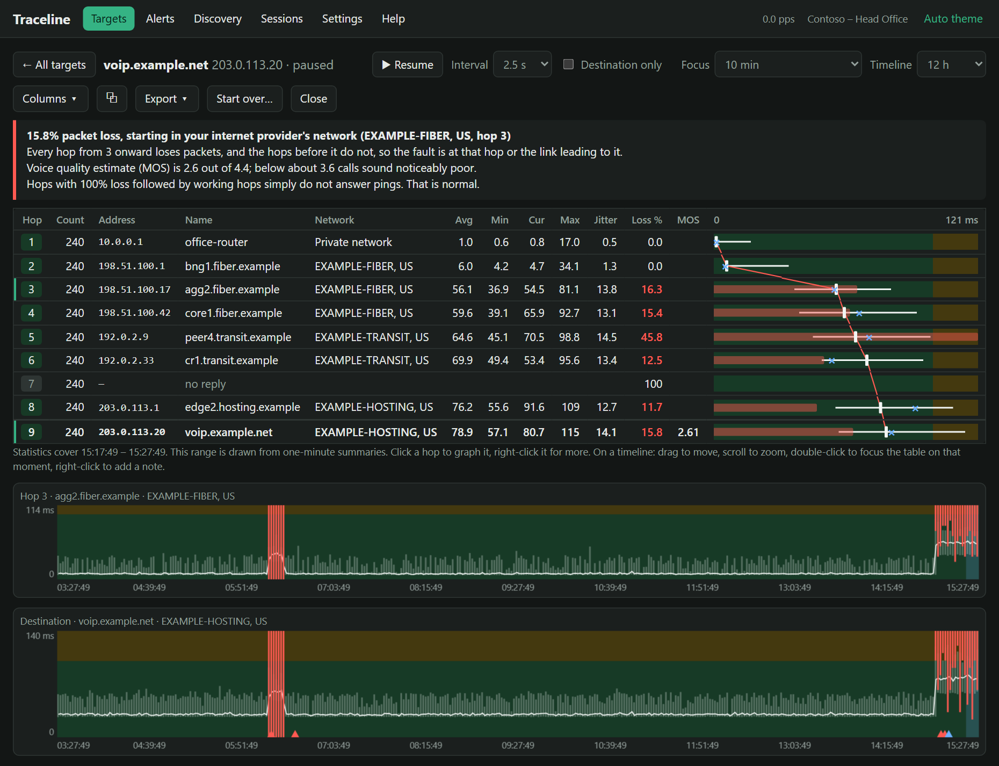
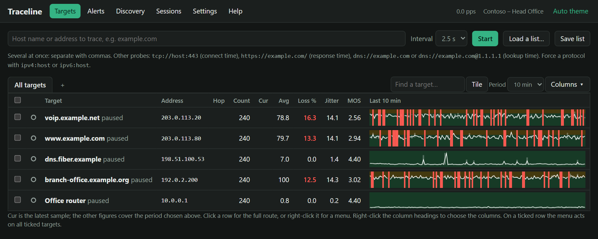
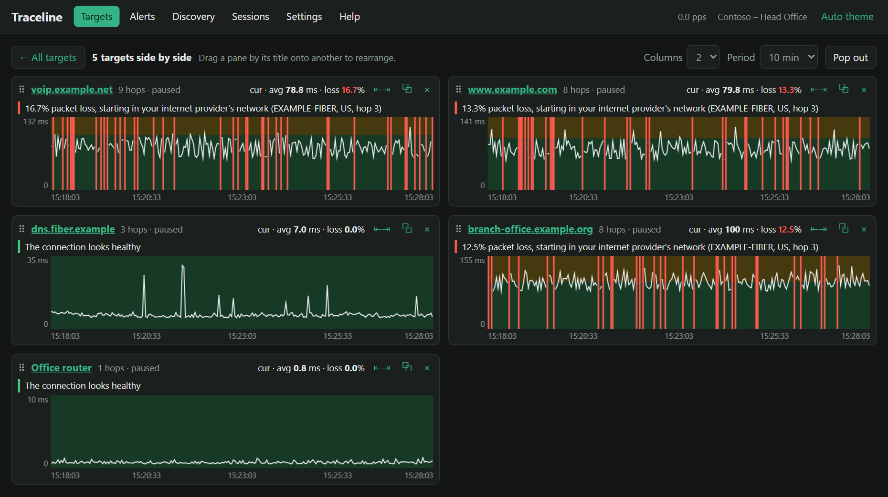
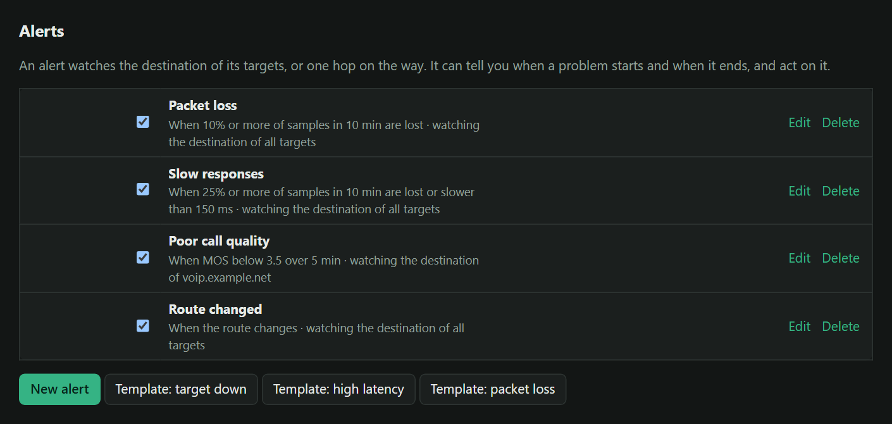
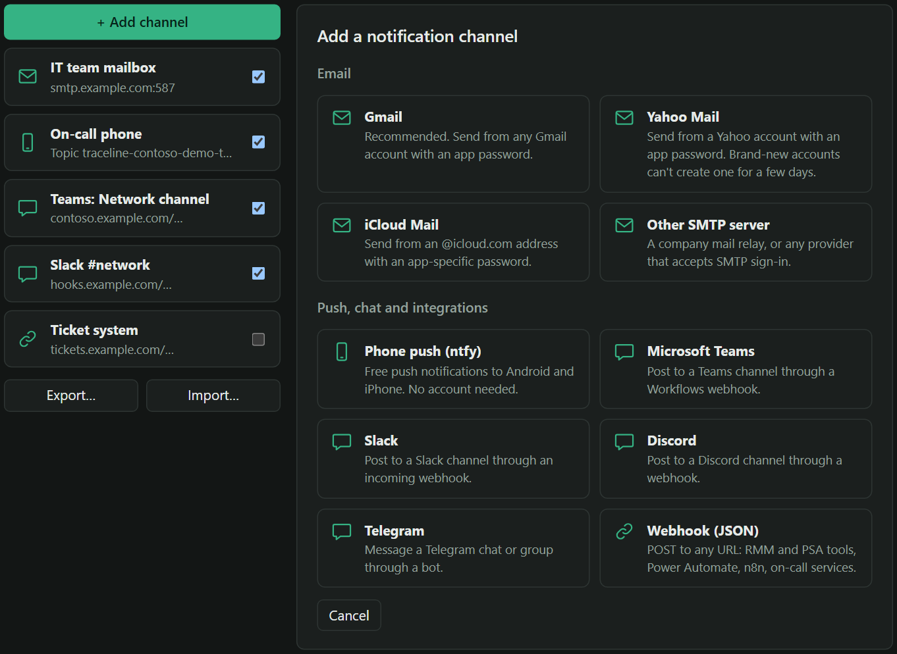
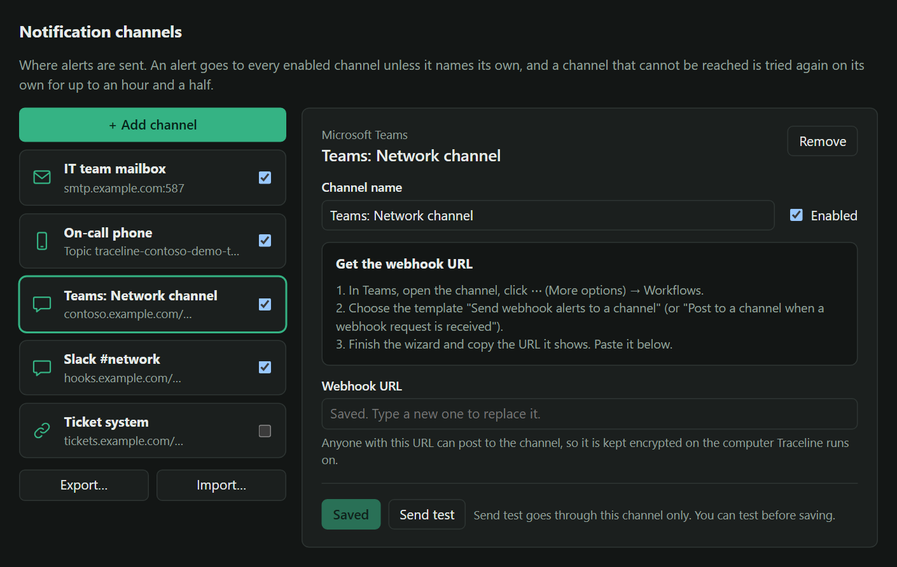

# Traceline

Traceline shows you **where a network connection goes wrong**. It traces the route to a target over and over, graphs latency and packet loss for every hop over time, says in plain words where the problem starts, and alerts you when it happens: by email, phone push, Microsoft Teams, Slack, Discord, Telegram or a JSON webhook.

Built for the situation where calls break up or a site keeps dropping and everyone blames someone else's network. Traceline runs as a small Windows service, keeps recording when nobody is signed in, and gives you the history to show your provider.



* **Download:** [Releases](https://github.com/dmajchrowski/Traceline/releases)
* **Using it:** [docs/USER-GUIDE.md](docs/USER-GUIDE.md), also built into the program under **Help**
* **What has and has not been checked:** [Tested](#tested), further down

Windows 10 / 11 and Windows Server, 64-bit. MIT licensed. The pictures on this page show made-up targets and addresses.

## What it tells you

| Question | Where Traceline answers it |
|---|---|
| Where does the trouble start? | The coloured box above the route: *"15.8% packet loss, starting in your internet provider's network (hop 3)"*. It names the first hop from which every later hop is affected, and whose network that hop is in |
| Is that hop really bad? | A hop that loses packets while the hops after it are fine only looks bad: many routers answer pings when they feel like it. Traceline says so instead of leaving you to guess |
| When did it happen, and for how long? | A timeline of latency, loss and optionally jitter for the destination and for any hop you click. Drag to move through history, scroll to zoom, double-click to see the route and its figures as they were at that moment |
| Did the route change? | Route changes are marked on the timeline, with the hop that changed |
| Are calls affected? | A voice-quality score (MOS) per target, from latency, jitter and loss |
| Is it only this target? | All targets in one list with a small graph each, summary screens you put together yourself, or several targets side by side |
| What was going on at the time? | Notes you leave on the timeline, next to the alerts that fired |

For every hop: count, average, minimum, current, maximum, jitter, loss and the network that owns the address, so you can see where your network ends and your provider's begins.

## Many targets



Type a host name or address and press **Start**. Routes are traced with ICMP, UDP or TCP packets. Three other kinds of probe sit next to a trace: TCP connect time (`tcp://host:443`), HTTP response time (`https://example.com/`) and DNS lookup time (`dns://example.com`).

**Tile** puts the targets side by side, each with what Traceline makes of it:



Also:

- **Workspaces** keep separate sets of targets, such as home and office, and **named configurations** keep packet type, timeouts, network interface, colour thresholds and graph scales, chosen per target.
- **Sessions.** Everything is recorded in one database file. A closed session can be reopened, exported and imported elsewhere.
- **Local network discovery** finds the devices on your network by ping sweep, ARP, mDNS and UPnP.
- **Remote agents.** One Traceline can trace from another computer that runs Traceline.
- **Sharing.** Read-only live links, accounts with three levels of access, a one-click report for your provider, and exports as CSV, text and picture.
- **HTTPS** for the web UI, with a certificate of your own or one Traceline makes for itself.

## Alerts



An alert watches the destination of its targets, or one hop on the way. It can fire on latency or loss over a period or over a number of samples, on voice quality below a value, on a route change, on an address appearing in the route, or on a timer. It tells you when the problem starts, when it ends and, if you want, again while it lasts.

Besides notifying, an alert can leave a note on the timeline, write to a log file, save a picture of the trace or the recent samples, attach both to an email, run a program, and switch a target between full-route and destination-only tracing. The **Alert log** lists every time an alert started or ended and saves as a file a spreadsheet opens.

## Where alerts go

<p>
  
  
</p>

| Channel | How it sends |
|---|---|
| **Gmail, Yahoo Mail, iCloud Mail** | App password over SMTP. Nothing for IT to set up |
| **Any SMTP server** | STARTTLS, SSL or plain, with or without sign-in |
| **Phone push (ntfy)** | Free push to Android and iPhone through ntfy.sh or your own ntfy server |
| **Microsoft Teams** | A Workflows webhook ("Send webhook alerts to a channel") |
| **Slack, Discord** | Incoming webhooks |
| **Telegram** | A bot you create with @BotFather; Traceline finds the chat ID for you |
| **Webhook** | A JSON `POST` to any URL: RMM and PSA tools, Power Automate, n8n, on-call services |

Alerts also show on the tray icon and, with a sound, in the browser. Each channel has **Send test**, and each channel's page shows the steps to get its app password, webhook URL or bot token. A channel that cannot be reached is tried again on its own for up to an hour and a half.

**Copy channels to another computer.** **Export…** writes the channels, with their passwords and webhook URLs, to a `.smchannels` file encrypted with a password you choose; **Import…** adds them on the other computer. [Service Monitor](https://github.com/dmajchrowski/ServiceMonitor) reads and writes the same files, so channels set up there work here and the other way round.

## Installing

Download `Traceline-Setup-<version>.exe` from [Releases](https://github.com/dmajchrowski/Traceline/releases) and run it (it asks for administrator rights itself). The setup is not code-signed yet, so Windows SmartScreen warns first: click **More info → Run anyway**. On PCs with Smart App Control turned on, Windows blocks it.

The setup:

- shows the [MIT License](LICENSE), which must be accepted;
- puts the program, `LICENSE.txt` and `THIRD-PARTY-NOTICES.txt` in `C:\Program Files\Traceline`;
- installs Traceline as a Windows service that starts with the computer and keeps recording when nobody is signed in;
- registers Traceline's two kinds of file (see below), so that double-clicking one opens it;
- adds a Start menu shortcut and an entry under **Installed apps**; a desktop shortcut and the tray icon at sign-in, unless you untick them; and, if you tick it, a Windows Firewall rule (only needed when you turn on access from other computers in Settings).

Recorded data and settings live in `C:\ProgramData\Traceline`. Running a newer setup updates in place, with Traceline open or not, and keeps them. Uninstalling removes the program, the service, the shortcuts and the file types, and asks whether to delete the data too; the answer is No unless you say otherwise.

Silent install and uninstall (the uninstall keeps the data):

```bat
Traceline-Setup-<version>.exe /VERYSILENT /SUPPRESSMSGBOXES /NORESTART
"C:\Program Files\Traceline\unins000.exe" /VERYSILENT /SUPPRESSMSGBOXES /NORESTART
```

Nothing else needs to be installed: the .NET runtime is built in. Traceline's own window uses Microsoft Edge WebView2, which Windows 11 has and Windows 10 normally has; without it, Traceline opens in your browser instead.

UDP and TCP route tracing need administrator rights. The service has them; a copy started by hand needs **Run as administrator**.

## First steps

1. Open **Traceline** from the Start menu, type a host name or address in the box on the Targets page and press **Start**.
2. Click the target to see its route. Click a hop to add its timeline; right-click it for more.
3. Read the coloured box above the table: it says what Traceline makes of the trace.
4. On the **Alerts** page, add a channel, press **Send test**, then create an alert from one of the templates.

The [user guide](docs/USER-GUIDE.md) covers the rest, including the keyboard shortcuts (Ctrl+N for a new trace, Ctrl+F to find a target, Ctrl+S to save a session).

## Traceline's own files

| File | What is in it |
|---|---|
| `.traceline` | A session: what one target recorded, for all time or for a period. Export it from a target's page or the Sessions page; any Traceline imports it |
| `.traceline-workspace` | A workspace: its targets with their settings and its summary screens, without what was recorded |

Where Traceline was installed with its setup, double-clicking either kind opens Traceline and imports it. Lists of targets are plain text files with one target per line.

## How it is built

One self-contained program (.NET 10) that probes, stores, alerts and serves its own UI:

```
Traceline.exe                      → traces, opens its own window (WebView2) and shows a tray icon
Traceline.exe --minimized          → the same, starting with only the tray icon
Traceline.exe --headless | --open  → no window: serves the UI at http://localhost:7878 (--open also opens the browser)
Traceline.exe --install-service | --uninstall-service   → the Windows service "Traceline" (LocalSystem), as the setup installs it
Traceline.exe <file>               → opens a .traceline or .traceline-workspace file
```

```
 Probers ──one round per interval──▶ Engine ──▶ SQLite: every sample, plus one-minute summaries
 ICMP / UDP / TCP routes               │         (C:\ProgramData\Traceline as a service,
 TCP connect, HTTP, DNS                │          %LOCALAPPDATA%\Traceline when started by hand)
                                       ├──▶ statistics, route changes, diagnosis in plain words
                                       ├──▶ alerts ──▶ notification queue ──▶ channels (retry)
                                       └──▶ web server on localhost ──live updates──▶ the UI
                                                                     in Traceline's window, a browser or a share link
```

| Folder | Contents |
|---|---|
| `src/Traceline.Core` | Probing, statistics, storage, alerts, notifications, diagnosis, discovery, reports |
| `src/Traceline.App` | Web server, live updates, service mode, the program window and tray icon |
| `web` | The UI (React and TypeScript, built with Vite) |
| `tests/Traceline.Core.Tests` | Unit tests |
| `build/` | `publish.ps1` (release build and setup), `make-icon.ps1`, license texts for the notices |
| `installer/` | `Traceline.iss`, the Inno Setup 6 script for the setup program |
| `docs/` | User guide, screenshots |

**Probing.** Each interval (2.5 s unless you change it) one packet goes to every hop, and who answered and how fast is stored as one row. Ping calls the Windows ICMP interface directly, which needs no administrator rights and measures to a fraction of a millisecond.

**Storage.** One SQLite file. Samples are kept for 30 days and the one-minute summaries, which long time ranges are drawn from, for a year; both can be changed.

**Access.** The UI answers on this computer only until you turn on access from other computers, which needs an administrator account first. Share links are read-only.

**Security.** Channel passwords, webhook URLs and bot tokens are encrypted with DPAPI in machine scope before they are stored, so they are useless on another computer, and the page never shows one again: a saved secret is an empty box that you type into to replace it. `.smchannels` exports carry them encrypted with your password (AES-256-GCM, key from PBKDF2-SHA256 with 600,000 iterations).

**Notifications** are adapted from [Service Monitor](https://github.com/dmajchrowski/ServiceMonitor), by the same author.

## Building

Requires Windows, the .NET 10 SDK, Node.js 22 or newer, and for the setup Inno Setup 6 (`winget install JRSoftware.InnoSetup`).

```powershell
cd web; npm ci; npm run build; cd ..          # the UI, into src\Traceline.App\wwwroot
dotnet test                                   # unit tests
dotnet run --project src/Traceline.App -- --open
.\build\publish.ps1 -Installer                # → dist\app\Traceline.exe (self-contained) and dist\Traceline-Setup-<version>.exe
```

The version is kept in one place, `Directory.Build.props`. `publish.ps1` also writes `THIRD-PARTY-NOTICES.txt` next to the exe: the license and notice texts of the .NET runtime and every package bundled into it, taken from the packages each build used.

`publish.ps1 -OtherSystems` makes Linux and macOS builds. They leave out the program window, the tray icon and picture export; there you use a browser. They compile, but have not been run on those systems.

**Screenshots.** The pictures in `docs/images` come from a copy of Traceline filled with made-up sessions: example names, and addresses from the ranges reserved for documentation.

## Tested

* 105 unit tests (`dotnet test`), run on GitHub Actions for every push. They drive the engine with a fake prober and a fake clock, so statistics, route changes, alert conditions, storage, diagnosis, channel export and file import are tested without a network.
* Against the system's own tools: hop lists match `tracert`, and latency at the destination matches `ping`, for three targets.
* Notification channels against the live services: a test message and a real alert were delivered through Gmail (app password), iCloud Mail, ntfy, Microsoft Teams, Slack, Discord and Telegram. Not tried with the live services: Yahoo Mail, and the "ended" and repeat messages.
* The setup on Windows Server 2025: a silent install, an update over the running service with Traceline's window open, the wizard with its License Agreement page and **Open Traceline** at the end, a silent uninstall (keeps the data), an uninstall that deletes the data, and an install while another copy held the port. With the setup of this release: a silent install, a session file and a workspace file opened through Windows as a double-click does (both were imported), and a silent uninstall that left nothing but the data.
* On a Windows 11 Pro PC: a silent install of 1.3.0, then every version up to 1.3.6 installed over the one before while the service was recording.
* Not checked: the setup on Windows 10; a double-click in Explorer by hand; a setup that was downloaded (SmartScreen); UDP and TCP route tracing over IPv6 beyond the local machine; the Linux and macOS builds.

## Limits

- Made for tens of targets, not hundreds. Destination-only tracing is the answer for longer lists.
- Email goes through SMTP with an app password. Signing in with Google or Microsoft is not offered.
- Files saved by other tools in their own formats cannot be opened. A comma-separated text export in the "one column per hop, one row per sample" layout can be imported.

## Privacy

Traceline sends nothing anywhere except the probes you ask for, the notifications you configure, and lookups you can switch off or never start: reverse DNS for hop names, Team Cymru's public DNS service for hop owners (public hop addresses only), and the IEEE's vendor list if you ask Discovery to download it.

## License

Traceline is open source under the [MIT License](LICENSE): free to use, change and redistribute, provided "as is" without warranty. The setup shows the license and installs it as `LICENSE.txt`.

The self-contained `Traceline.exe` includes the .NET runtime (MIT, .NET Foundation), NuGet packages such as MailKit and MimeKit (MIT), SQLite and the Microsoft Edge WebView2 SDK, and the web UI includes React (MIT). `build\publish.ps1` writes their license and notice texts to `THIRD-PARTY-NOTICES.txt` next to the exe, and the setup installs that file too.

The notification code in `src/Traceline.Core/Notifications` is adapted from [Service Monitor](https://github.com/dmajchrowski/ServiceMonitor), and the part of `src/Traceline.App/MainWindow.cs` that chooses where the window keeps its browser profile from [PortBridge](https://github.com/dmajchrowski/PortBridge); both are by the same author under the MIT License. Hop owner labels come from the IP-to-ASN mapping service run by [Team Cymru](https://www.team-cymru.com/ip-asn-mapping).

Traceline is an independent project. It is not affiliated with, endorsed by, or derived from the code of any commercial network monitoring product.

## Ideas for later

* Code-sign `Traceline.exe` and the setup program (removes the SmartScreen warning and the Smart App Control block)
* Check for a newer version from the Help page
* A metrics endpoint for Grafana or Home Assistant
* Alerts on "unusual for this time of day" instead of fixed thresholds
